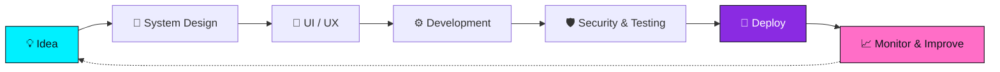

<!-- ═══════════════════ HEADER ═══════════════════ -->
<div align="center">
  

  <a href="https://github.com/azaanp0">
    
  </a>

  <br><br>

  
  
  
  <br><br>
  
  
</div>

<br>

<!-- ═══════════════════ ABOUT ═══════════════════ -->
## 🧑‍💻 About Me


```js
const azaam = {
  name: "Azaam Aqil",
  role: ["IT Engineer", "Full-Stack Developer", "System Designer"],
  mission: "Build software that is secure, scalable and beautiful",
  philosophy: "Code is poetry, architecture is art 🎨",
  currentlyLearning: ["System Design", "Cloud & DevOps", "Cyber Security"],
  superpower: "Turning complex problems into simple, elegant solutions",
  askMeAbout: ["Web Development", "IT Solutions", "System Architecture"],
  funFact: "I debug in my sleep... and sometimes it works 😴🐛"
};
```

- 💻 **IT Engineer & Full-Stack Developer**
- 🛠️ Building secure, scalable, and modern web applications.
- 🎯 Focused on: Clean code, System design, IT Infrastructure.
- 🎨 I treat every interface like a canvas and every system like a masterpiece.
- 🌱 Constantly learning and adapting to new technologies.
- 💬 Ask me about **Web Development, IT Solutions, or System Architecture**.

<br clear="both"/>

<!-- ═══════════════════ WHAT I DO ═══════════════════ -->
## 🌌 What I Do

<div align="center">

| 🎨 Frontend Craft | ⚙️ Backend Power | 🏗️ System Design | 🛡️ IT & Security |
|:---:|:---:|:---:|:---:|
| Responsive, animated, pixel-perfect UIs | REST APIs, auth, databases | Scalable architectures & clean structure | Servers, networks, hardening |
| React • TypeScript • CSS | Node.js • Express | Diagrams • Patterns • Planning | Linux • Nginx • Docker |

</div>

<!-- ═══════════════════ SKILLS ═══════════════════ -->
## 🛠️ Tech Stack & Skills

<p align="center">
  <strong>🎨 Frontend</strong><br>
  
</p>
<p align="center">
  <strong>⚙️ Backend & Databases</strong><br>
  
</p>
<p align="center">
  <strong>🧰 IT, DevOps & Tools</strong><br>
  
</p>

### 📈 Skill Levels

<div align="center">

| Skill | Level |
|:--|:--|
| 🌐 Web Development |  |
| 🏗️ System Design |  |
| 🐧 Linux & IT Infrastructure |  |
| 🎨 UI / UX Design |  |
| 🐳 Docker & DevOps |  |
| 🛡️ Security Awareness |  |

</div>

<!-- ═══════════════════ WORKFLOW ═══════════════════ -->
## 🧠 How I Build Things



<!-- ═══════════════════ CURRENT FOCUS ═══════════════════ -->
## 🔭 Current Focus

<div align="center">

| 🔥 Working On | 📚 Learning | 🎯 Goals |
|:---:|:---:|:---:|
| Modern full-stack apps | Advanced System Design | Build products people love |
| Clean architecture | Cloud & CI/CD | Master DevOps & Security |
| Store & business systems | AI-powered tooling | Contribute to open source |

</div>

<!-- ═══════════════════ TROPHIES ═══════════════════ -->
## 🏆 GitHub Trophies
<div align="center">
  
</div>

<!-- ═══════════════════ STATS ═══════════════════ -->
## 📊 GitHub Stats & Activity

<div align="center">
  
  
</div>

<div align="center">
  
  
</div>

<div align="center">
  
</div>

<!-- ═══════════════════ SNAKE ═══════════════════ -->
## 🐍 Contribution Snake
<div align="center">
  
</div>

<!-- ═══════════════════ PROJECTS ═══════════════════ -->
## 🚀 Featured Projects

<div align="center">
  <a href="https://github.com/azaanp0/my_Profile">
    
  </a>
  <a href="https://github.com/azaanp0/abufaisal-tv-store">
    
  </a>
</div>

<!-- ═══════════════════ PRINCIPLES ═══════════════════ -->
## 💎 My Engineering Principles

<div align="center">

| 🧼 Clean | 🔒 Secure | 📦 Scalable | 🎨 Beautiful | ⚡ Fast |
|:---:|:---:|:---:|:---:|:---:|
| Readable code that lasts | Security from day one | Built to grow | Design that inspires | Performance matters |

</div>

<!-- ═══════════════════ QUOTE ═══════════════════ -->
## 💭 Daily Dose of Inspiration
<div align="center">
  
</div>

<!-- ═══════════════════ CONNECT ═══════════════════ -->
## 🤝 Connect with Me

<p align="center">
  <a href="https://www.linkedin.com/in/azaam-alamrani-a1292b355">
    
  </a>
  <a href="https://www.instagram.com/yzi7i_">
    
  </a>
  <a href="https://www.facebook.com/share/17rDnLk33U/">
    
  </a>
  <a href="https://github.com/azaanp0">
    
  </a>
</p>

<div align="center">
  
</div>

<div align="center">
  
</div>
